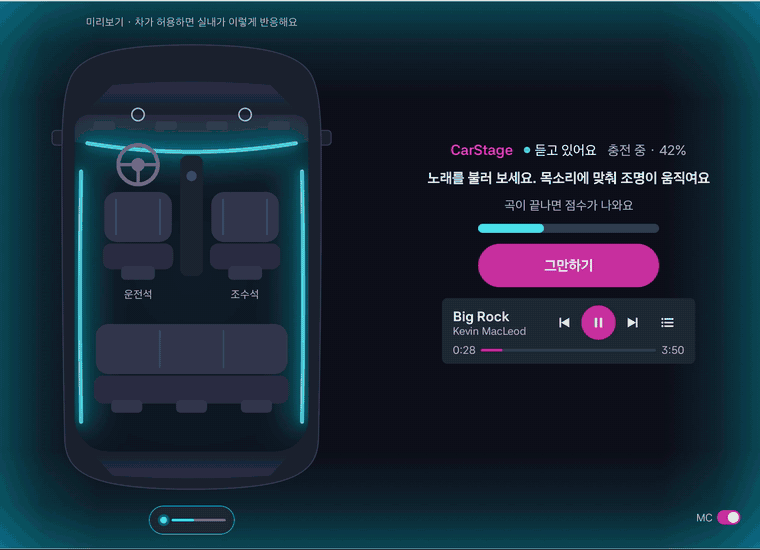
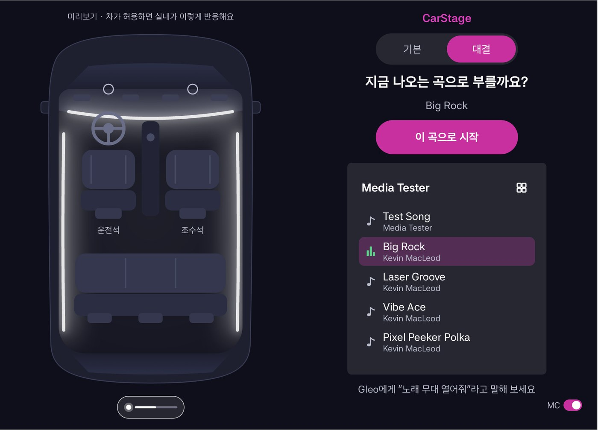
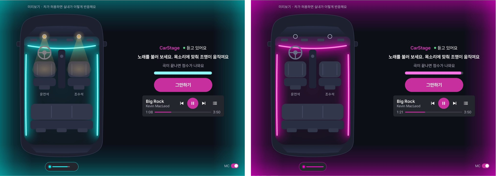
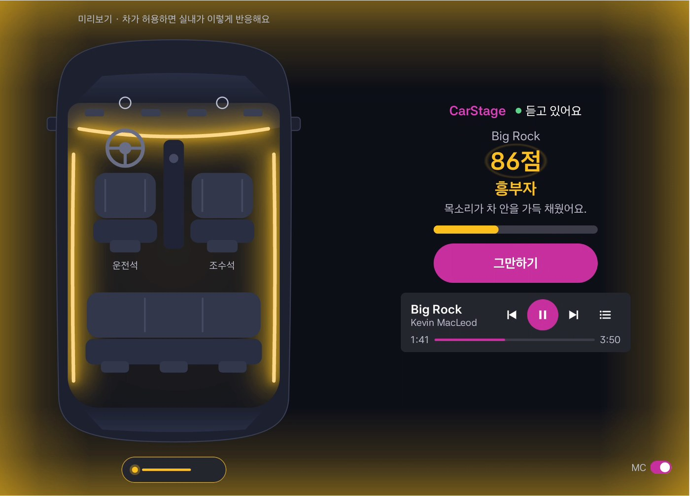
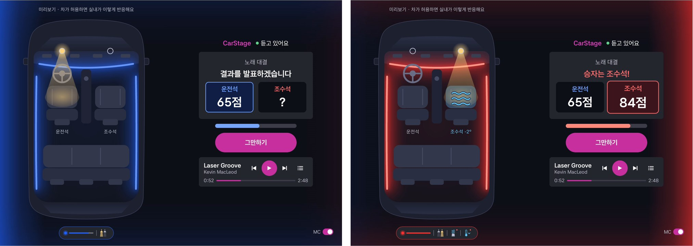
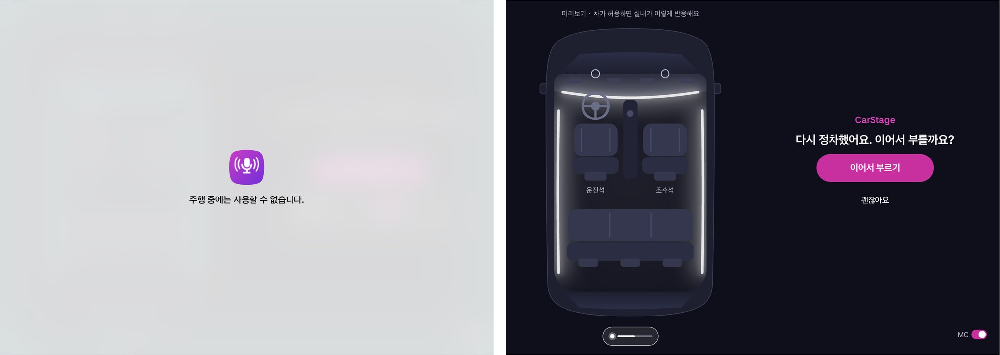
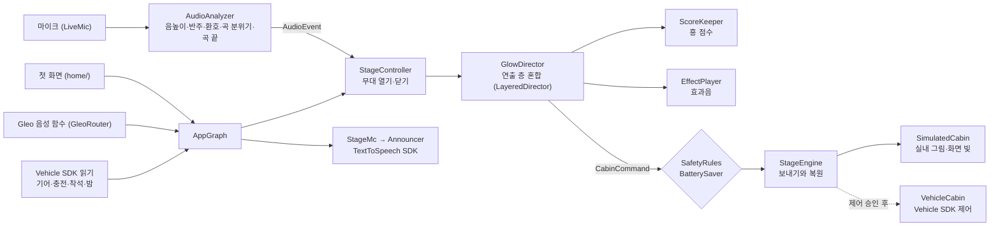

# CarStage (카스테이지)

> 멈춰 있는 차 안에서 함께 노래를 부르면, 차가 탑승자의 목소리와 환호에 반응해 차 안을 우리만의 무대로 바꿔 주는 엔터테인먼트 앱입니다.

현대자동차그룹 차량용 앱 개발 공모전 출품작입니다. 팀은 **cold-box**이고, Pleos App Market 카테고리는 엔터테인먼트입니다.

**[심사용 APK](apk/cold-box_CarStage_release.apk)** · **[시연 영상 (1분 53초)](https://github.com/cold-box/carstage/releases/download/v0.1.0/cold-box_CarStage_demo.mp4)** · **[실행 방법](#실행-방법-pleos-connect-emulator-210)** · **[음악 앱 없이 바로 보기](#음악-앱-없이-바로-보기)** · **[문서](docs/README.md)**

<p align="center"></p>
<p align="center"><sub>Pleos Connect Emulator 2.1.0에서 실제로 동작하는 화면입니다. 음악만 흐를 때는 청록빛이고, 따라 부르기 시작하면 목소리에 맞춰 자홍빛으로 밝아집니다.</sub></p>

## 왜 만들었나요

정차와 충전으로 차에 머무는 시간은 늘었지만, 그 시간에 탑승자가 함께할 거리는 많지 않습니다. 차량 노래방 앱은 화면 속 반주와 채점에 맞춰져 있고, 음악 연동 조명은 재생 중인 음악 신호를 따라갑니다. 두 방식 모두 노래하는 사람의 목소리와 함께 있는 사람들의 환호에는 반응하지 않습니다.

CarStage에서는 노래를 부르면 차가 빛과 소리로 답하고, 그 답에 탑승자가 다시 환호합니다. 앱은 음원·가사·반주를 제공하지 않고, 사용자가 차의 음악 앱으로 듣던 노래를 그대로 씁니다.

## 주요 기능

| 기능 | 하는 일 |
|---|---|
| ① 곡 하나로 시작하는 무대 | 차의 음악 앱에서 듣던 곡이나 노래 목록의 곡을 고르면 재생과 무대가 함께 시작합니다. "Gleo, 노래 무대 열어줘"로도 엽니다. |
| ② 목소리와 환호에 반응하는 빛 | 음악만 흐를 때는 곡의 박자에 맞춰 청록빛이 숨 쉬고, 따라 부르면 목소리 크기와 음높이에 맞춰 자홍빛으로 밝아지며, 환호가 터지면 빛이 출렁입니다. |
| ③ 흥 점수와 피날레 | 곡이 끝나면 참여·열기·호응·완창으로 흥 점수를 매기고, 등급에 맞는 박수·팡파레와 빛으로 공개합니다. 음정이 아니라 함께 부른 만큼 점수가 나옵니다. |
| ④ 차를 아는 MC | Pleos TextToSpeech로 밤, 이번 주행 시간, 충전 잔량, 앞좌석 인원에 맞춰 인사하고, 곡 제목과 점수를 불러 줍니다. |
| ⑤ 2인 노래 대결 | 앞좌석에 두 명이 앉으면 대결을 제안합니다. 드럼롤과 빛이 운전석과 조수석을 오가다 승자 쪽에서 멈추고, 그쪽 독서등·바람·시트 통풍이 축하합니다. |
| ⑥ 상황 인식과 안전 | 기어가 P일 때만 열리고, 출발하거나 전화가 오면 무대를 닫고 실내 설정을 되돌린 뒤, 다시 정차하면 이어서 부를지 묻습니다. 밤에는 조명을 낮추고, 배터리가 부족하면 공조·시트 연출을 멈춥니다. |

| 첫 화면 | 노래 모드와 목소리 모드 |
|---|---|
|  |  |
| **점수 공개** | **2인 대결 발표** |
|  |  |
| **출발하면 닫고, 정차하면 다시 묻기** | |
|  | |

실내 조명·공조·시트 연동은 Pleos Vehicle 제어 권한이 승인되면 켜지는 기능입니다. 연출 엔진은 차량 출력까지 구현되어 있고, 심사용 APK는 같은 반응을 화면 빛, 효과음, MC 음성, 실내 그림 미리보기로 보여 줍니다. 그래서 위 장면의 실내 그림 위에는 "미리보기 · 차가 허용하면 실내가 이렇게 반응해요"가 보입니다.

## 심사용 APK

- 위치: [`apk/cold-box_CarStage_release.apk`](apk/cold-box_CarStage_release.apk) (같은 파일이 [Release v0.1.0](https://github.com/cold-box/carstage/releases/tag/v0.1.0)에도 있습니다)
- 팀 서명 키로 서명한 release 빌드입니다. Pleos 앱 심사는 승인되지 않은 차량 권한을 선언하거나 그 API를 부르는 앱을 통과시키지 않으므로, 이 빌드는 차량 제어 권한(`CONTROL_CAR_*`, `CAR_LIGHTS`)을 선언하지 않고 제어 코드도 넣지 않았습니다. 제어 권한을 협의하면 빌드 스위치(`app/build.gradle.kts`의 `releaseDrivesCabin`)를 켜서 다시 빌드합니다.
- 화면 빛, 효과음, MC 음성, 흥 점수, 2인 대결, 차량 상태 읽기(기어, 충전, 착석, 밤)는 모두 동작합니다.

## 실행 방법 (Pleos Connect Emulator 2.1.0)

1. 공모전 개발 가이드대로 Android Studio에 Pleos Connect 에뮬레이터 이미지를 설치하고, AVD(Automotive, Pleos Connect v2.1.0 프로필, 콜드 부팅, RAM 4GB)를 만들어 켭니다.
2. 마이크를 켭니다. Android Studio에서 켠 에뮬레이터는 마이크가 무음이므로 `adb emu avd hostmicon`을 실행하거나, Extended Controls > Microphone에서 "Virtual microphone uses host audio input"을 켭니다. macOS가 마이크 접근을 물으면 허용합니다.
3. APK를 설치합니다.

    ```bash
    adb install -r -g apk/cold-box_CarStage_release.apk   # -g는 마이크 권한을 미리 허용합니다. 빼면 처음 곡을 시작할 때 묻습니다
    ```

4. 앱 목록에서 CarStage를 엽니다. 무대는 기어가 P(정차)일 때만 열리므로, Pleos Connect Virtual Console에서 기어가 P인지 확인합니다.

### 음악 앱 없이 바로 보기

에뮬레이터의 기본 음악 앱은 곡을 재생하지 않습니다. 그래서 Gleo가 CarStage의 음성 함수를 부를 때와 같은 명령으로 무대를 엽니다.

1. 첫 화면 위의 [기본 | 대결]에서 **[대결]**을 고릅니다. [기본]은 음악이 나올 때만 Gleo 실행을 받습니다.
2. 무대를 엽니다. MC가 인사하고, 화면 가장자리와 실내 그림이 빛나기 시작합니다.

    ```bash
    adb shell am start -a OPEN_STAGE -p com.carstage.app --es ACTION_PARAM '{}'
    ```

3. 맥의 마이크에 대고 노래하거나 박수·환호를 보냅니다. 따라 부르면 빛이 목소리에 맞춰 자홍으로 밝아지고, 환호에는 출렁입니다.
4. 10초 이상 부른 뒤 곡을 끝내면, 흥 점수가 박수 효과음과 MC의 칭찬과 함께 공개됩니다.

    ```bash
    adb shell am start -a FINISH_SONG -p com.carstage.app --es ACTION_PARAM '{}'
    ```

5. 2인 대결은 `-a START_BATTLE`로 시작합니다. 운전석과 조수석이 차례로 10초 이상 부르고 차례마다 `FINISH_SONG`을 보내면, 드럼롤과 빛이 좌우를 오가는 결과 발표 뒤 승자 쪽이 빛납니다.

2026-11-10에 에뮬레이터에서 음악 앱 없이 이 순서(무대 열기, 곡 끝내기, 대결 두 차례, 발표)를 끝까지 확인했습니다([docs/05](docs/05-emulator-findings.md)).

### 차량 상태에 따라 바뀌는 것

Pleos Connect Virtual Console에서 차량 상태를 바꾸며 봅니다.

| 바꿀 것 | 앱의 반응 |
|---|---|
| 무대 중에 기어를 D로 | 무대를 닫고 실내 설정을 되돌립니다(Pleos가 앱 화면을 가립니다). 다시 P로 바꾸면 "다시 정차했어요. 이어서 부를까요?"를 묻습니다 |
| 충전을 켜고 잔량을 바꿈 | 상태 줄에 "충전 중 · 42%"가 보이고, 무대를 열 때 MC가 배터리를 말하며 인사합니다 |
| 잔량을 20% 미만으로, 충전은 끔 | 공조·시트를 켜거나 올리는 연출을 멈추고 안내합니다 |
| 무대 중에 전화 걸기(`adb emu gsm call 01012345678`) | 마이크와 무대를 멈추고, 통화가 끝나면 이어서 부를지 묻습니다 |

실차에서는 멜론, 블루투스 같은 차의 음악 앱으로 듣던 곡을 고르면 재생과 무대가 함께 시작합니다. 에뮬레이터에서 이 흐름을 보려면 이 저장소의 시험 음악 앱(`tools/mediatester`, 아래 "개발용 도구")을 빌드해 설치합니다.

## 테스트 환경과 필요한 설정

| 항목 | 내용 |
|---|---|
| 확인한 환경 | Apple Silicon 맥(macOS), Pleos Connect Emulator 2.1.0(Android 14, API 34) |
| 앱 | minSdk 28, targetSdk 35, Kotlin 2.0과 Jetpack Compose |
| 필요한 권한 | 마이크(필수). 알림 접근은 선택이며, 켜면 다른 음악 앱의 곡 제목과 위치를 보여 줍니다(설정 > 앱 > 알림 액세스) |
| 네트워크 | 필요하지 않습니다. MC 음성도 기기 안에서 만듭니다(`ON_DEVICE`) |
| 지키는 원칙 | 정차 중에만 동작합니다. 소리는 기기 안에서 분석한 뒤 바로 버리고, 녹음·저장·전송하지 않습니다 |

## Pleos 플랫폼 활용

| Pleos 기능 | CarStage에서 쓰는 곳 |
|---|---|
| Vehicle SDK 2.3.2 (읽기) | 기어(P일 때만 무대를 엶), 성에 제거·와이퍼(작동 중이면 공조 연출을 건너뜀), 전기차 배터리와 충전(상태 줄, MC 인사, 배터리 보호, 충전 완료 때 마지막 곡 제안), 앞좌석 착석(대결 제안), 주행 기록(MC 인사) |
| Vehicle SDK 2.3.2 (제어, 승인 후) | 앰비언트 조명의 색·밝기, 운전석·조수석 독서등, 좌석별 온도와 풍량, 시트 통풍. 무대가 끝나면 모두 시작 전 값으로 되돌리고, 앱이 강제 종료되어도 다음 실행 때 복원합니다 |
| TextToSpeech SDK 3.3.1 | MC 음성과 대결 발표. `ON_DEVICE` 모드라 네트워크가 필요 없고, 효과음과 같은 오디오 포커스 규칙을 따릅니다 |
| Gleo App Schema | `OPEN_STAGE`(무대 열기), `START_BATTLE`(대결), `FINISH_SONG`(곡 끝내기). 응답은 한국어로 하고, MC가 이어서 말할 때는 Gleo가 효과음만 냅니다 (`app/src/main/assets/schema.json`) |
| Android Automotive 표준 | 주행 규제(`CarUxRestrictionsManager`), 밤(`NIGHT_MODE`), 차의 연료 종류, 다른 앱의 음악 재생 상태와 노래 목록(`MediaBrowserService`) |
| Pleos 디자인 기준 | Pleos 글자 체계, 76dp 이상의 터치 영역, 4.5:1 이상의 글자 대비, 누를 때의 클릭 소리와 진동, 앱 자리를 둘로 나눈 세로 한 칸(841dp) 배치 |

## 안전과 개인정보

- **정차 중에만 동작합니다.** 무대는 기어 P와 주행 규제 없음을 확인한 뒤에만 열리고, 무대 동안 기어를 0.5초마다 확인합니다. 출발하면 무대를 닫고 실내 설정을 되돌립니다. 주행 중에 차가 거절한 복원은 정차하면 다시 시도합니다.
- **차의 설정을 반드시 되돌립니다.** 연출이 처음 바꾸기 직전의 값을 기록해 두고, 무대가 어떻게 끝나든(그만하기, 출발, 통화, 강제 종료) 그 값으로 복원합니다. 외부 조명은 제어하지 않습니다.
- **소리를 남기지 않습니다.** 마이크는 사용자가 노래를 시작한 뒤에만 켜고, 소리는 기기 안에서 분석한 뒤 바로 버립니다. 녹음·저장·전송 기능은 없고, 음악이 나오는지는 마이크가 아니라 Android 재생 상태로 판단합니다.
- **눈부시지 않게 합니다.** 밤에는 앰비언트 밝기를 40% 이하로 낮추고, 빛은 1초에 3번 넘게 깜빡이지 않습니다.
- **배터리를 지킵니다.** 충전 중이 아닌데 잔량이 20% 미만이면 공조·시트 연출을 멈추고, 엔진 차는 무대가 30분을 넘으면 공회전을 한 번 알립니다.

## 구조



| 패키지 (`app/src/main/java/com/carstage/app/`) | 하는 일 |
|---|---|
| `audio/` | 마이크 캡처, 음높이(YIN), 반주 추정과 목소리 대비 크기, 환호·곡 분위기·곡 끝 판정, 효과음, MC 음성, 통화와 음악 재생 감지 |
| `stage/` | 연출 엔진. 층(참여, 곡 분위기, 환호, 피날레, 대결)이 대상별로 원하는 값을 내면 혼합기가 합치고, 엔진이 차량과 시뮬레이터에 보내고 끝나면 복원합니다 |
| `score/` | 흥 점수(참여 30, 열기 25, 호응 35, 완창 10)와 등급 |
| `safety/` | 기어·주행 규제·성에 제거·와이퍼에 따른 안전 규칙과 무대 중 감시 |
| `vehicle/` | Pleos Vehicle SDK 세션, 배터리·착석·주행 기록·밤 읽기 |
| `home/`, `ui/` | 무대 화면, 실내 시뮬레이터, 점수 공개, 대결 카드, 디자인 토큰 |
| `media/` | 차의 음악 앱에서 노래 목록을 받아 곡을 고르면 재생 |
| `gleo/` | Gleo 음성 함수를 무대 동작으로 옮기고 응답 |

출시 빌드는 `app/src/noCabinControl`(제어 권한을 빼는 매니페스트, 차량 출력 없음)을, 개발 빌드는 `app/src/cabinControl`(차량 출력)과 개발용 진단 화면 `app/src/debug`(Lab)를 씁니다.

## 품질과 검증

- **단위 테스트 661개**(72개 파일): 오디오 분석, 흥 점수, 연출 혼합, 안전 규칙, 복원, 대결, MC 문장, 화면 배치를 차 없이 시험합니다.
- **lint 경고 0개 유지**: 경고가 하나라도 있으면 검사가 실패합니다(`warningsAsErrors`). 출시 빌드 lint는 빠진 제어 권한을 쓰는 코드가 남지 않았는지도 찾습니다.
- **에뮬레이터 회귀 시험**: `scripts/regress.sh`가 Gleo 열기·대결·닫기, 출발로 닫기와 복원, 강제 종료 뒤 복원, 밤 조명 낮춤, MC 켜고 끄기, 주행 시간 인사, 화면을 벗어날 때 닫기, 통화(`--call`)를 시나리오마다 로그로 PASS/FAIL 판정합니다.
- **에뮬레이터 검증 기록**: Pleos Connect Emulator 2.1.0에서 SDK의 지원 범위, 실패 코드, 지연 시간, 화면 배치를 날짜와 로그 요약으로 남겼습니다([docs/05](docs/05-emulator-findings.md)).
- **고정한 개발 환경**: SDK 패키지와 Pleos 이미지를 sha1로 고정해, 새 맥에서도 스크립트 하나로 같은 환경을 만듭니다(아래 "소스에서 빌드하기").

## 소스에서 빌드하기

개발 환경은 **Apple Silicon 맥(macOS)** 기준으로 고정했습니다. Pleos 이미지를 arm64용으로 고정했고, 검증도 이 환경에서 했습니다.

| 구성 요소 | 고정한 버전 | 고정한 곳 |
|---|---|---|
| Gradle | 8.14.6 (배포 파일 sha256 검증) | `gradle/wrapper/gradle-wrapper.properties` |
| 빌드용 JDK | Temurin 21 (없으면 Gradle이 자동으로 받음) | `gradle/gradle-daemon-jvm.properties` |
| AGP, Kotlin, 라이브러리 | AGP 8.8.2, Kotlin 2.0.0, Pleos Vehicle 2.3.2, TextToSpeech 3.3.1 | `gradle/libs.versions.toml` |
| Android SDK | platform-tools 37.0.1, emulator 37.2.12, build-tools 35.0.0, platform 35 rev 2 | `toolchain/android-sdk.lock` |
| Pleos 에뮬레이터 이미지 | Pleos Connect v2.1.0 (arm64) | `toolchain/android-sdk.lock` |
| AVD | `Pleos_Connect_v2.1` (RAM 4GB, 콜드 부팅, 호스트 GPU, 마이크 입력) | `toolchain/avd/config.ini` |

1. **Android Studio 설치**: `brew install --cask android-studio` 또는 [공식 사이트](https://developer.android.com/studio)에서 받습니다. 따로 설치할 JDK는 없습니다. 스크립트가 Android Studio에 들어 있는 JDK로 Gradle을 실행하고, 빌드용 Temurin 21은 Gradle이 처음 빌드할 때 받아 옵니다.
2. **저장소 받기**: `git clone https://github.com/cold-box/carstage.git && cd carstage`
3. **환경 설치**: `scripts/bootstrap.sh`
    - `toolchain/android-sdk.lock`에 적힌 SDK 패키지와 Pleos 이미지를 내려받아 sha1을 확인한 뒤 `~/Library/Android/sdk`에 설치하고, AVD와 `local.properties`를 만듭니다.
    - 내려받는 양은 약 5.3GB이고, 설치 후 약 25GB를 차지합니다. 중간에 끊겨도 다시 실행하면 이어 받습니다.
    - 처음에 Android SDK 라이선스(Google)와 Pleos Connect SDK 라이선스(42dot) 동의를 묻습니다.
4. **에뮬레이터 실행**: `scripts/run-emulator.sh` (콜드 부팅과 호스트 마이크 연결). 처음 켜면 macOS가 에뮬레이터(qemu)의 마이크 접근을 묻습니다.
5. **빌드와 검사**: `scripts/check.sh`
    - 단위 테스트, 디버그 빌드, lint, 출시 빌드 컴파일과 출시 빌드 lint를 한 번에 돌립니다. 마지막 줄이 `scripts/check.sh: all checks passed.`이면 통과입니다.
6. **점검**: `scripts/doctor.sh --device`
    - 모든 버전이 고정값과 같은지 확인한 뒤, 에뮬레이터에 앱을 설치하고 마이크 신호와 차량 기어 읽기를 시험합니다. 마지막 줄이 `All checks passed.`이면 같은 환경입니다.
7. **설치**: `adb install -r -g app/build/outputs/apk/debug/app-debug.apk` (개발 빌드는 차량 제어와 개발용 진단 화면이 켜진 빌드입니다)

| 증상 | 확인할 것 |
|---|---|
| `doctor.sh`에서 패키지가 FAIL | `scripts/bootstrap.sh`를 다시 실행합니다 |
| AVD 설정이 FAIL | `scripts/bootstrap.sh --recreate-avd` (에뮬레이터 안의 앱 데이터가 지워집니다) |
| 마이크가 FAIL (no host audio) | `adb emu avd hostmicon`을 실행하고, 시스템 설정 > 개인정보 보호 및 보안 > 마이크에서 에뮬레이터(qemu)를 허용합니다 |
| 빌드가 JDK 오류로 실패 | `./gradlew` 대신 `scripts/gradle.sh`로 실행합니다 |

Android Studio에서는 위의 1~3단계를 마친 뒤 저장소 폴더를 열면 됩니다. Device Manager에서 `Pleos_Connect_v2.1`을 켰다면 마이크가 무음이므로 `adb emu avd hostmicon`을 실행합니다.

## 개발용 도구

| 도구 | 하는 일 | 사용법 |
|---|---|---|
| Lab 진단 화면 | 개발 빌드에만 있는 진단 화면입니다. 오디오 입력, 차량 기능의 지원 범위와 쓰기 반영, 배터리·재생·통화 상태, 분석 CPU, 시험 연출과 복원, 주행 상태를 확인합니다 | 첫 화면 오른쪽 위 "개발자 Lab", 또는 `adb shell am start -n com.carstage.app/.MainActivity --es probe all` → `adb logcat -d -s CarStageLab:I -v raw` |
| `scripts/regress.sh` | 에뮬레이터 회귀 시험을 돌리고 시나리오마다 PASS/FAIL을 냅니다. 시험 동안 효과음을 끄고, 끝나면 차량 상태와 설정을 되돌립니다 | `scripts/regress.sh --install` (시나리오만: `scripts/regress.sh gleo drive`) |
| `scripts/replay.sh` | 녹음 파일을 마이크 대신 무대에 넣어 재생하고, 분석 결과 줄을 출력합니다. 노래하지 않고도 연출 기준을 맞출 때 씁니다 | `scripts/replay.sh <녹음 파일>` (기어 P에서) |
| `scripts/vconsole.sh` | Virtual Console을 명령줄로 조작해 기어, 충전, 잔량 같은 차량 상태를 바꿉니다 | `scripts/vconsole.sh gear D`, `charging on`, `soc 42` |
| `tools/mediatester` | 멜론 같은 다른 앱이 음악을 트는 상황을 흉내 내는 시험 음악 앱입니다. `MediaBrowserService`와 `MediaSession`을 갖춰 곡 목록을 내주고 미디어 키로 조작됩니다 | `scripts/gradle.sh :mediatester:assembleDebug` → 설치 → `scripts/media-library.sh <곡 파일>` → `adb shell am start -n com.carstage.mediatester/.TesterActivity --es cmd play` |
| `tools/score-scenes` | 공개 라이선스 곡의 목소리와 반주를 나눠 "곡만", "따라 부름", "열창" 같은 흥 점수 시험 장면을 만듭니다 | [docs/09](docs/09-voice-reaction-plan.md) 5장 "흥 점수 v2" |
| `scripts/release-apk.sh` | 팀 서명 키로 release APK를 만들고, 서명자와 차량 제어 권한이 빠졌는지 확인합니다. 키와 비밀번호는 저장소 밖의 비밀번호 관리자에 둡니다 | `scripts/release-apk.sh --out apk/cold-box_CarStage_release.apk` |

## 문서

기획과 검증 문서는 [docs/](docs/README.md)에 있습니다.

| 문서 | 내용 |
|---|---|
| [04 노래방 기획](docs/04-karaoke-plan-v2.md) | 모드 구조, 피날레, 2인 대결과 발표, 사업 모델 |
| [05 에뮬레이터 검증](docs/05-emulator-findings.md) | Pleos Connect Emulator 2.1.0에서 확인한 SDK 지원 범위, 실패 코드, 지연 시간 |
| [07 생활 편의 기능](docs/07-convenience-features.md) | 음악 감지 실행 제안, 충전·배터리 연동, 통화 중 멈춤, 자동 정리와 복원 |
| [09 목소리 반응 설계](docs/09-voice-reaction-plan.md) | 목소리와 음악을 나누는 방법, 환호 감지, 세 층 반응, 흥 점수, 저장·공유하지 않는 원칙 |
| [10 UI/UX 기획](docs/10-ui-ux-plan.md) | Pleos 디자인 기준, "차가 무대가 된다" 콘셉트, 상태별 화면 배치, 스타일 가이드 |
| [11 차량 제어 없이](docs/11-no-control-plan.md) | 차량 제어 권한이 없을 때도 남는 기능과 화면·소리로 대신하는 연출 |
| [12 차를 아는 MC](docs/12-mc-plan.md) | MC가 말하는 때와 문장, 효과음·Gleo와 겹치지 않는 규칙 |
| [13 기본 시나리오](docs/13-basic-flow.md) | 곡을 고르면 시작하고 "그만하기"로 끝나는 기본 흐름 |

## 개발 방식

이 저장소는 Claude Code와 함께 개발했습니다. 레포 루트의 `CLAUDE.md`와 `.claude/rules/`(영어)에 빌드 명령, 구조, 지켜야 할 규칙(무대는 한 입구로만 열고 닫음, 새 연출 대상에는 안전 판단을 반드시 정함, 연출이 끝나면 반드시 복원)과 제품 원칙을 적어 두었습니다. 기능 하나마다 브랜치와 PR을 만들고, 코드를 바꾸면 커밋 전에 리뷰 플러그인(`/pr-review-toolkit:review-pr`)으로 리뷰한 뒤, 충돌·빌드·테스트·에뮬레이터 확인·문서 반영을 확인해 머지했습니다.

## 출처

### 효과음 출처

앱의 효과음은 모두 CC0(퍼블릭 도메인 기증) 음원입니다. CC0는 출처 표시 의무가 없지만 확인할 수 있게 적어 둡니다. 원본은 `scripts/sound-effect.sh <원본> <이름>`으로 모노로 줄이고 음량을 맞춘 뒤(EBU R128 -19 LUFS 목표, 정점 -1.5 dBTP 이하) Ogg Opus 48 kHz로 저장했습니다.

| 앱의 파일 | 쓰는 곳 | 원본 | 만든 사람 | 출처 | 라이선스 |
|---|---|---|---|---|---|
| `app/src/main/res/raw/sfx_applause.ogg` | 피날레의 "좋음"과 "최고"(팡파레와 함께) | `Well Done CCBY3.ogg` (박수, 4.1초) | qubodup | [OpenGameArt "Well Done"](https://opengameart.org/content/well-done) | CC0 (2024-10-05에 CC-BY 3.0에서 바뀜, 파일 이름의 "CCBY3"는 옛 표기) |
| `app/src/main/res/raw/sfx_applause_short.ogg` | 피날레의 "기본" | 위 박수의 0.8~2.4초(앞 0.05초는 서서히 키우고 끝 0.4초는 서서히 줄임). 만든 명령: `ffmpeg -ss 0.8 -t 1.6 -i app/src/main/res/raw/sfx_applause.ogg -af "afade=t=in:st=0:d=0.05,afade=t=out:st=1.2:d=0.4,aresample=48000" -ac 1 -c:a libopus -b:a 96k app/src/main/res/raw/sfx_applause_short.ogg` | qubodup | 위와 같음 | CC0 |
| `app/src/main/res/raw/sfx_drumroll.ogg` | 2인 대결 발표, 좌우가 번갈아 켜질 때 | `Drum_Roll_Intro.ogg` (드럼롤, 4.0초, 원본 5.1채널) | Iwan Sounds and DIY | [Wikimedia Commons](https://commons.wikimedia.org/wiki/File:Drum_Roll_Intro.ogg) | CC0 1.0 |
| `app/src/main/res/raw/sfx_fanfare.ogg` | 2인 대결 승자 발표, 피날레의 "최고"(박수와 함께) | `jingles_SAX07.ogg` (Music Jingles 묶음의 색소폰 징글, 1.7초) | Kenney (kenney.nl) | [Kenney "Music Jingles"](https://kenney.nl/assets/music-jingles) | CC0 1.0 |

### 코드 출처

- 에코 제거 필터(`app/src/main/java/com/carstage/app/audio/echo/MdfFilter.kt`)는 SpeexDSP의 `libspeexdsp/mdf.c`(Copyright (C) 2003-2008 Jean-Marc Valin, BSD 3-clause)의 다중 지연 블록 주파수 영역 필터를 따라 이 앱에 맞게 새로 작성했습니다.

### 시연 영상과 화면의 음악

- 시연 영상과 화면에 나오는 곡은 Kevin MacLeod의 "Big Rock", "Laser Groove", "Vibe Ace"(incompetech.com, [CC BY 3.0](https://creativecommons.org/licenses/by/3.0/))입니다. 앱은 음원을 포함하지 않으며, 시험 음악 앱(`tools/mediatester`)에 넣어 재생했습니다.
- 시연 영상의 탑승자 노래는 시험 녹음을 마이크 입력 대신 넣었고, 영상의 소리에는 담지 않았습니다. 실내 그림은 차량 제어 승인 전의 미리보기입니다.
